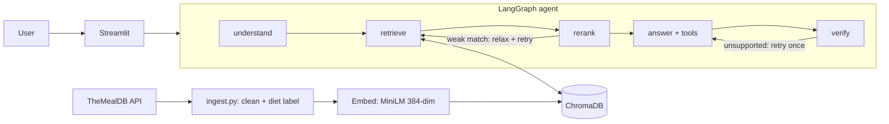

# 🍳 Fridge Chef

An agentic RAG app: type what's in your fridge, get a recipe grounded in a real recipe database, with substitutions, nutrition notes, and a self-check.

**Data:** pulled automatically from [TheMealDB](https://www.themealdb.com/api.php) (free public API), no manual CSV.

## Architecture



## Concepts and where they live

| Concept | Where |
|---|---|
| Data pipeline | `ingest.py`: API fetch with retries, dedupe by id, cache, diet labelling, idempotent upserts |
| Embeddings + vector DB | `retrieval.py`: MiniLM sentence embeddings, ChromaDB with cosine distance |
| RAG | semantic search -> metadata filter -> rerank -> grounded answer |
| Metadata filtering | hard diet constraint inside the vector query |
| Reranking | blends vector similarity with ingredient coverage |
| LangChain | structured output (Pydantic), `@tool` tools, provider-agnostic LLM (`llm.py`) |
| Tools / agent | `search_recipes`, `substitute_ingredient`, `get_nutrition`; LLM decides when to call them |
| LangGraph | 5 nodes, shared state, 2 conditional loops |
| Guardrails | diet filter, capped retries and tool steps, verifier node |
| Evaluation | `eval.py`: automatic hold-out recipe recall, rerank ablation, diet-safety check |

## Run

```bash
pip install -r requirements.txt
export GROQ_API_KEY=your_key      # free; or LLM_PROVIDER=google / ollama (see llm.py)
python ingest.py                  # downloads recipes + builds the vector DB
python graph.py                   # test the agent in the terminal
streamlit run app.py              # UI
python eval.py --n 200            # retrieval evaluation -> eval_results.md
```

## Results

_Run `python eval.py` and paste your table here. Report only what you measured._

## Limitations (be honest in interviews)

- Dataset is ~300 recipes from a crowd-sourced source, so coverage is limited.
- Diet labels are heuristic (category + ingredient keywords). "Vegetarian" includes dairy and eggs.
- The eval measures retrieval only (hold-out recipe recall). Queries are built from a recipe's own ingredients, so it is easier than real use. End-to-end answer quality is judged by the verifier node, not a human-labelled set.
- Nutrition values come from a small hand-made table.
- TheMealDB's free test key is meant for development and learning; check their terms before any public release.